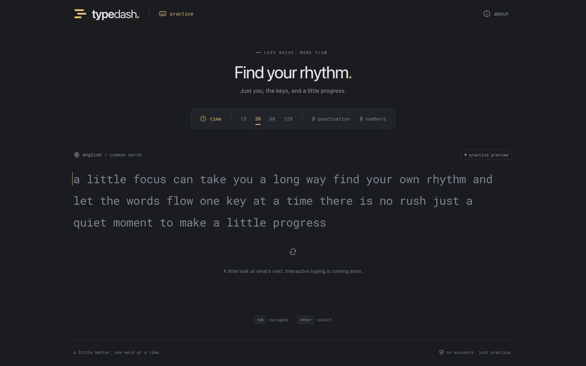
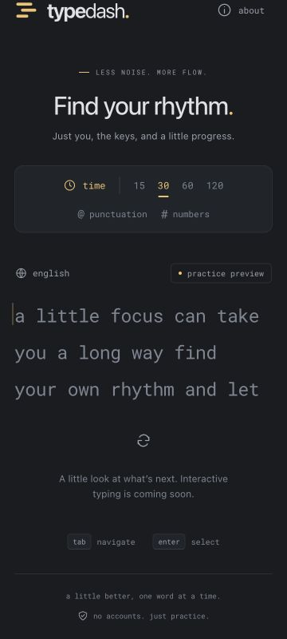

**Phase 1 handoff — foundation and UI shell**

Completed November 3, 2026. Phase 2 is awaiting user approval.

**Delivered**

- React/TypeScript/Vite project, npm lockfile, Node 24 declaration, ESLint, Vitest, and Playwright configuration.
- Responsive dark TypeDash shell with original SVG branding, amber theme tokens, a self-hosted monospace font, sample-text refresh, an accessible About dialog, and a keyboard skip link. The interface explicitly identifies the prompt as a preview.
- Framework-independent engine types and configuration defaults. No reducer, real timer, score display, or persistence has been implemented.
- Four observed reference behavior traces and six hand-calculated scoring fixtures. Fixture tests verify internal arithmetic; Phase 2 must test the implemented engine against them.
- Production asset-budget enforcement, asset attribution, and development documentation.

**Validation**

| Check | Result |
| --- | --- |
| ESLint | Passed with no warnings. |
| TypeScript | Application, configs, fixtures, and browser test source passed. |
| Vitest | Six fixture-arithmetic checks passed. |
| Production build | Passed; output is `dist/`. |
| Initial JavaScript | 70,546 bytes gzip against a 100,000-byte budget. |
| Initial assets | 102,290 bytes gzip against a 200,000-byte budget, conservatively including both WOFF and WOFF2 font alternatives. |
| Local HTTP | Development preview returned 200; production preview loaded successfully. |
| Responsive review | 360, 768, and 1440-pixel layouts had no horizontal document overflow. Saved desktop and mobile screenshots come from the production build. |
| Interaction review | Sample refresh changes the prompt; About opens and dismisses with Escape; focus returns to its trigger; keyboard access to the skip link and focus transfer to the main region work. |
| Font | Local Roboto Mono loaded in the production preview. |

Browser verification used the in-app browser through the supported computer-use tools. The nine Playwright cases were discovered successfully with `npx playwright test --list`; the standalone Chromium/Firefox/WebKit suite has been authored but was not executed in this phase. Actual mobile keyboard testing and typing latency measurements belong to later phases, once real input exists.

`npm audit --omit=dev` reported zero production dependency vulnerabilities. The full audit reported 11 moderate development-tool findings cascading from the `minimatch <11.0.1` advisory in the ESLint toolchain ([advisory](https://github.com/advisories/GHSA-g3hv-75wg-m249)). Keep this tracked for toolchain maintenance; do not force a downgrade or an unverified major dependency override to suppress the report. This dependency is not shipped to visitors.

**Review artifacts**

To run the interface, use `npm run dev`. To review the production build, run `npm run build` followed by `npm run preview`. Local QA servers are stopped at the end of the phase.

**Next phase, subject to approval**

Implement the 30-second English typing experience: deterministic word generation, actual input and editing, character feedback, deadline-based timing, a basic result summary, and restart. Replay the fixtures against the engine and validate a complete browser flow before proposing phase 3.
