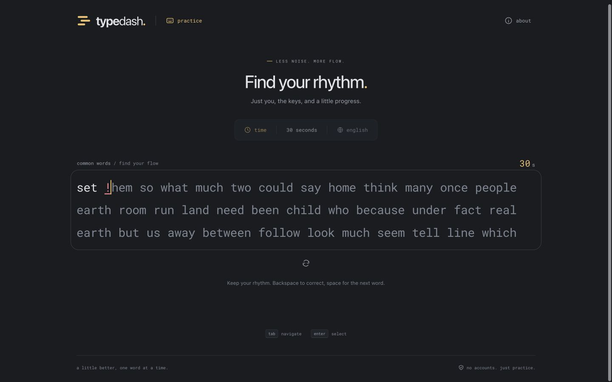
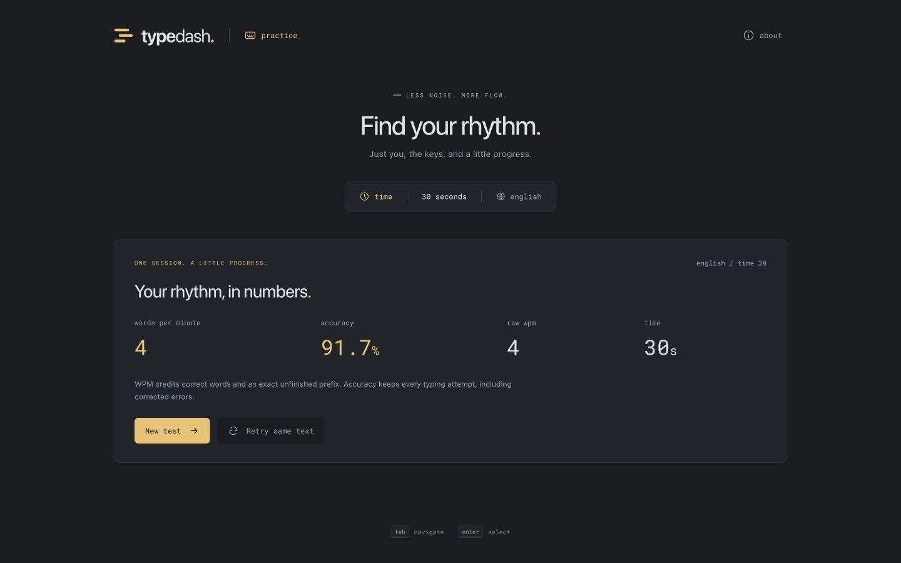
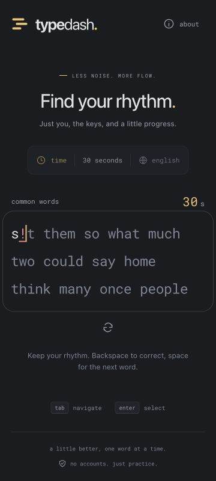

**Phase 2 handoff — core typing experience**

Completed November 3, 2026. Phase 3 is awaiting user approval.

**Delivered**

- A working 30-second English test using an independently assembled, locally bundled common-word list and reproducible seeds.
- Native input handling, immediate correct/incorrect/extra/missed feedback, Space submission, Backspace, word deletion shortcuts, and composition handling. Paste and drop are blocked in test input.
- A framework-independent immutable reducer with absolute deadline checks. Late input cannot alter an expired result; late timer callbacks do not extend the duration. Focus loss or opening About does not pause the clock.
- A bounded 64-word rendered prompt, caret visibility handling, and cached completed-word totals. Minimal generation at the end of a timed buffer ensures the current test cannot exhaust its text; configuration controls remain reserved for phase 3.
- Basic results for WPM, raw WPM, accuracy, and elapsed time, plus new-test and same-text retry actions. Correcting an error updates the final text while preserving the original attempt in accuracy.
- Updated About copy, keyboard restart, accessible start/finish announcements, result-heading focus, and cleanup of native listeners and scheduled clocks when the test restarts or unmounts.

**Validation**

| Check | Result |
| --- | --- |
| ESLint and TypeScript | Passed. |
| Unit tests | 38 passed across four files: scoring fixture arithmetic, engine replay/editing/generation, clock lifecycle, and native input handling. |
| Golden scoring traces | All six independent fixtures replay correctly against the reducer. |
| Deadline checks | Exact-deadline insertion/deletion rejected; idle and delayed ticks finish at the configured duration; post-finish input ignored. |
| Clock/input cleanup | Pending callbacks and native listeners are removed; stale ticks cannot start an abandoned test. |
| Production build | Passed; no dependencies were added this phase. |
| Initial JavaScript | 74,763 bytes gzip against the 100,000-byte budget. |
| Initial assets | 106,965 bytes gzip against the 200,000-byte budget, including conservative counting of both font formats. |
| Real browser flow | Development and production builds both completed an actual 30-second test and displayed the expected result. |
| Editing and restart | Incorrect-character feedback, correction, same-text retry, new-test generation, Tab → Enter restart, and return of focus to the input verified. A ready test remained ready after the abandoned run's old deadline. |
| Long input | 120 extra/mismatched characters were fully retained and cleared with word deletion. Browser automation typed bounded batches to stay within its per-action execution limit. |
| Responsive review | Ready/typing/result layouts checked at 360 px; ready layouts checked at 768 and 1440 px; no horizontal document overflow. These checks use a resized desktop browser, not actual mobile hardware. |

The production trace used target words `set them so`. Input was `set`, Space, `!`, Backspace, `them`, Space, `so`, followed by idle time until the deadline. This leaves 11 retained and credited units, with 11 correct attempts out of 12 total. Expected WPM and raw are both 4.4 (displayed as 4), accuracy is 91.7%, and elapsed time is 30 seconds. The observed UI matched all values. The test finished while About remained open, verifying that a dialog does not pause time. Retrying restored the same word sequence.

Browser verification ran through the supported in-app browser tools. Eighteen standalone Playwright cases across Chromium, Firefox, and WebKit were discovered and type-checked. That standalone suite was not executed here; comprehensive cross-browser runs, actual mobile keyboard checks, and measured latency/load targets remain part of release validation. The existing development-only dependency advisory is recorded in the phase 1 report; dependency inputs and lockfile are unchanged.

**Review artifacts**

Run `npm run dev` to try the application. For a production preview, use `npm run build` and `npm run preview`. QA servers are stopped at the end of this phase.

**Next phase, subject to approval**

Expose all time and word presets, punctuation and number options, configuration reset behavior, focus-loss recovery, and expanded prompt/restart validation. Charts, detailed character breakdowns, saved history, and personal bests remain reserved for phase 4.
