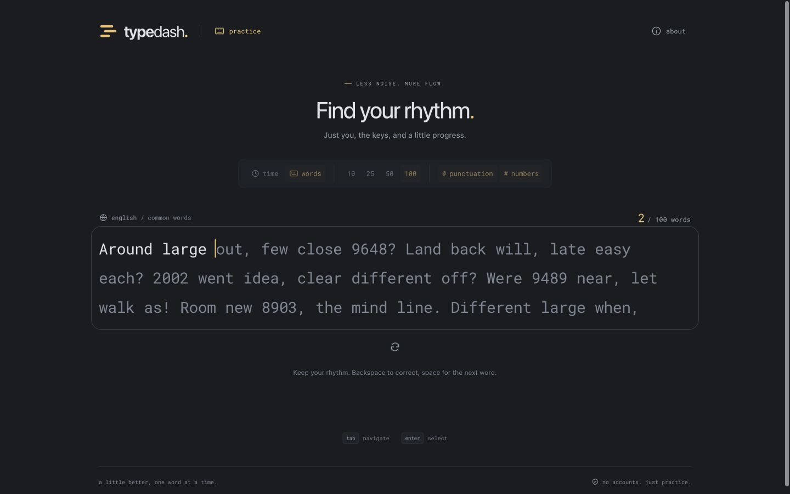
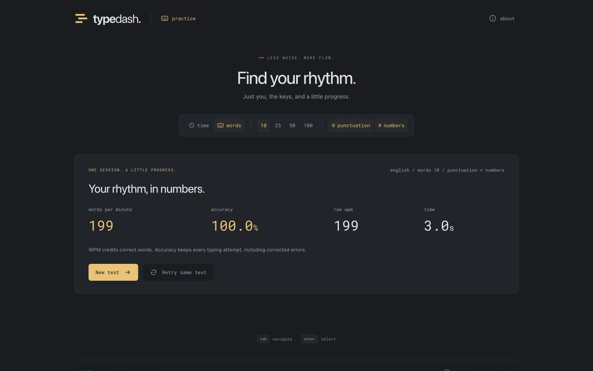
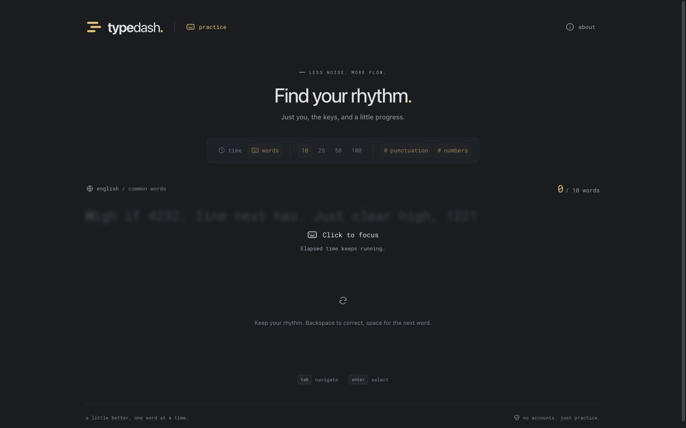
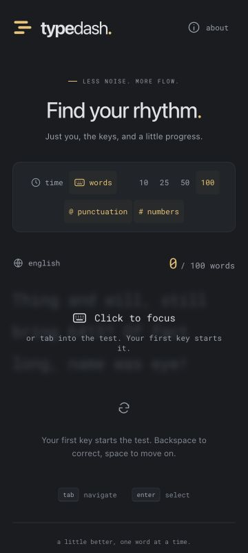

**Phase 3 handoff — test modes and controls**

Completed November 3, 2026. Phase 4 is awaiting user approval.

**Delivered**

- Time presets of 15, 30, 60, and 120 seconds; word presets of 10, 25, 50, and 100 words. Time mode defaults to 30 seconds and word mode to 25 words. Each mode remembers its last length during the current page session.
- Deterministic punctuation and number generation, independently toggleable and available together. Capitalization and punctuation are part of the exact typing target. Enabled options appear in short tests as well as extended timed prompts.
- Configuration changes abandon the active run and reset its seed, text, counters, deadline, composition buffer, and pending focus restoration. Selecting the current mode or length leaves the run intact. Configuration controls retain keyboard focus while being adjusted.
- Restart and New test retain the current settings while generating new text; Retry same text retains both settings and the complete target sequence.
- A focus overlay that blurs the prompt, explains that active tests keep running, and restores input without clearing typed text. Keyboard users can tab directly into the textarea. Input, window-focus, clock, and pending animation callbacks are cleaned up appropriately.
- Word-count progress, dynamic result metadata, and fractional elapsed seconds for short word tests. Word mode has no deadline and does not need idle timer polling before timeline sampling is introduced.
- Responsive controls with accessible labels and pressed states. English remains the content language; no login, backend, or paid service was introduced.

**Validation**

| Check | Result |
| --- | --- |
| Lint, TypeScript, and production build | Passed. |
| Unit tests | 83 passed across five files, including the existing independent scoring fixtures and 45 new mode/configuration cases. |
| Preset completion | All four time lengths and four word counts completed with all four punctuation/number combinations in engine tests. Timed input is rejected exactly at the configured deadline; word tests end on their final correct character without a trailing Space. |
| Extended prompts | All four modifier combinations reproduced 320 target words across several generated batches in simulated 120-second tests, with correct totals and no prompt exhaustion. |
| Resets and retries | Engine tests cover abandoned deadlines, replacement timed deadlines, and 12 consecutive same-seed retries preserving the full modified prompt. |
| Browser preset controls | All eight presets selected successfully and displayed the expected countdown or word count. Switching modes remembered 120 seconds and 100 words independently. |
| Browser word completion | A real 10-word test with punctuation and numbers completed at 100.0% accuracy without a trailing Space; results correctly identified its mode, count, and modifiers. Retry reproduced all ten targets and kept all settings. |
| Browser focus recovery | Leaving input for About showed the overlay. Restoring focus preserved the retained correct character and active run. An actual 15-second test finished correctly while unfocused, demonstrating that the overlay does not pause time. |
| Browser mode changes and keyboard restarts | Switching an active timed run to words cleared old input and returned to ready. The abandoned deadline did not finish the replacement test. Three Tab → Enter restarts cleared input while preserving the selected 100-word count and modifiers. |
| Responsive and bounded rendering | No horizontal document overflow at 360, 768, or 1440 px. A 100-word prompt mounted only 64 nearby word elements. These are desktop-browser viewport checks, not actual mobile keyboard verification. |
| Initial JavaScript | 75,969 bytes gzip against the 100,000-byte budget. |
| Initial assets | 108,385 bytes gzip against the 200,000-byte budget, including conservative counting of both font formats. |

The completed browser word trace was `High if 4232, line next has. Just clear high, 1221`. After five submitted words, progress displayed `5 / 10`; entering the remaining words completed the run without a final Space. Its result showed `english / words 10 / punctuation + numbers`, 100.0% accuracy, and 3.0 seconds elapsed. Retrying restored the exact sequence, including case and punctuation.

Browser checks used the production build through the supported in-app browser tools. Thirty standalone Playwright cases across Chromium, Firefox, and WebKit were discovered and type-checked; that standalone suite was not executed here. Comprehensive cross-browser execution, actual mobile hardware checks, and measured loading/typing latency targets remain part of release validation. Dependency inputs and the lockfile are unchanged; the development-tool advisory noted in the phase 1 report remains tracked there.

**Review artifacts**

Use `npm run dev` to try TypeDash. A production preview uses `npm run build` followed by `npm run preview`. QA servers are stopped at the end of the phase.

**Next phase, subject to approval**

Add timeline samples and a speed chart, detailed character counts, persisted settings, the latest 100 local results, and personal bests for comparable test configurations. These features remain entirely in the browser and require no account or backend.
