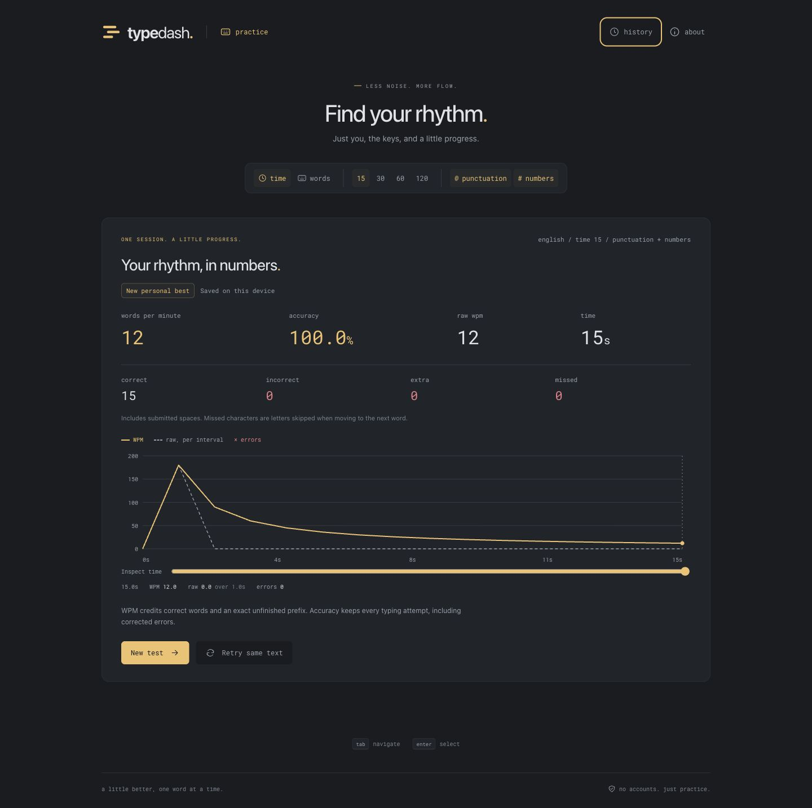
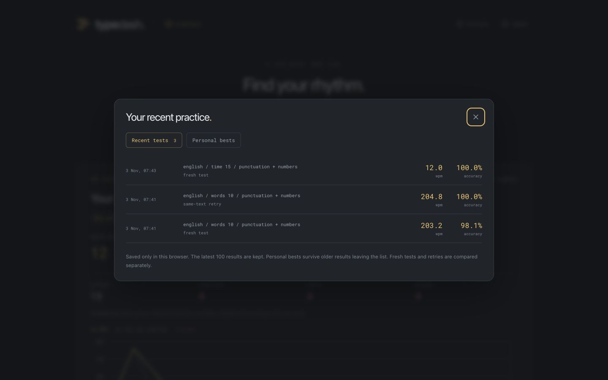
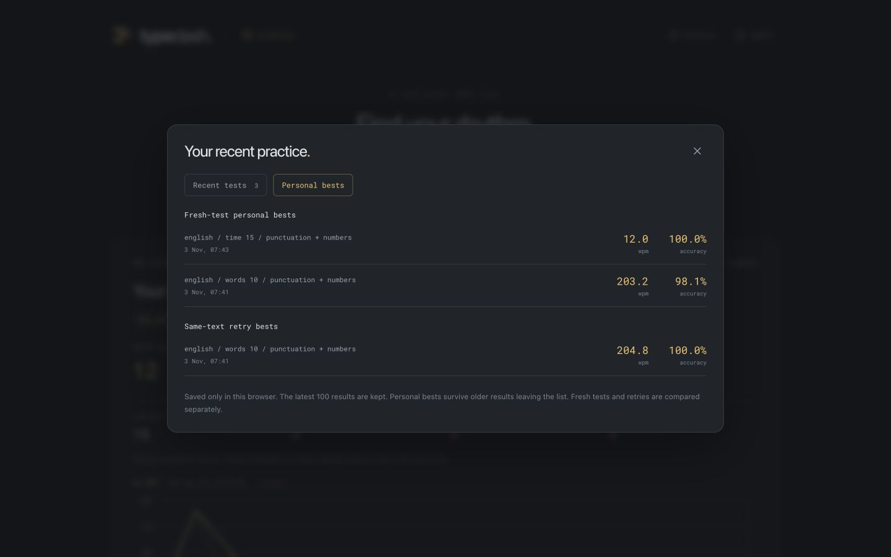
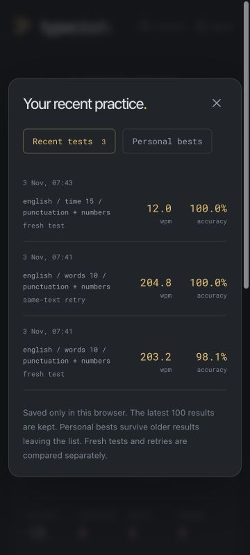

**Phase 4 handoff — results and local progress**

Completed November 3, 2026. Phase 5 is awaiting user approval.

**Delivered**

- A speed chart with cumulative WPM, interval raw speed, corrected-error markers, pointer inspection, and a keyboard slider. Graphs include idle periods and the final partial interval. Long word runs adapt their interval to keep at most 300 points.
- Correct, incorrect, extra, and missed character counts, explained separately from attempt-based accuracy.
- Versioned browser-local settings, including the active mode, modifiers, and each mode's remembered length. Reload restores the selected configuration.
- Automatic, idempotent saving for completed nonempty runs. Stable IDs distinguish same-text retries, and repository-owned deferred saves survive a quick restart. Pending saves flush before page exit.
- A working History dialog with the latest 100 results, inspectable stored charts, and separate personal-best and retry-best groups. Best summaries survive history pruning and compare only matching configurations and scoring versions.
- Validation and recovery for malformed data, read failures, write/quota failures, and unknown newer schemas. In-memory fallback is clearly labeled. All data stays in the browser.
- Chart and history code split from the typing screen. No dependencies, authentication, application backend, or paid API were added.

**Validation**

| Check | Result |
| --- | --- |
| Lint, TypeScript, production build | Passed. |
| Unit tests | 106 passed across seven files, including 23 new sampling, clock, and storage cases. |
| Timeline correctness | Independent timestamp traces cover one-second and partial intervals, late ticks, idle raw speed, exact-boundary tick/input ordering, corrected errors, negative net character changes, and deadline rejection. A simulated day-long idle word run remains bounded and ends at the correct duration. |
| Persistence invariants | Deferred writes, lazy history loading, duplicate run IDs, reload restoration, merging previously saved rows, and pruning to 100 records pass. A pruned older personal best survives reload. |
| Best-score isolation | Fresh/retry categories, different modes/counts, modifiers, and scoring versions have separate bests. Full precision and accuracy tie-breaking pass. |
| Recovery | Malformed JSON, invalid rows/graphs, blocked storage, quota failure, empty/abandoned tests, and unknown newer schemas pass unit checks. Newer envelopes are not overwritten. |
| Real browser settings | Word count 10, punctuation, numbers, and remembered time length 120 seconds survived reload. |
| Real browser results | A fresh modified word test saved once; a corrected error produced the expected 98.1% accuracy and a graph error marker while final character errors were zero. A same-text retry saved separately at 100.0% accuracy and set a retry best without replacing the fresh-test best. |
| Real browser reload/history | Both word-test records survived reload. Their history details and charts opened. After a timed run, history contained exactly three records, despite graph interactions, modal opens, and rerenders. |
| Timed score/idle graph | Typing `All both much, ` retained 15 correct units in a 15-second test. The UI showed 12 WPM, 12 overall raw WPM, 100.0% accuracy, 15 correct characters, and 15 seconds. The final interval correctly showed zero raw speed after idle time. |
| Keyboard and responsive review | Chart slider inspection worked. Escape dismissed History and restored focus to its opener. Result/chart/history/detail views had no horizontal page overflow at 360 px; result layouts also passed 768 and 1440 px. The 360 px chart used a measured 278-unit viewBox for readable labels. |
| Initial JavaScript | 80,527 bytes gzip against the 100,000-byte budget. |
| Initial assets | 113,702 bytes gzip against the 200,000-byte budget, conservatively counting both font alternatives. |

The browser checks ran against the production build through the supported in-app browser tools. Forty-two standalone Playwright cases were discovered and type-checked, including new persistence, graph, corruption, and blocked-storage flows. That standalone cross-browser suite was not executed here. Recovery failure modes were exercised in unit tests; actual mobile hardware and measured loading/input-latency targets remain part of release validation.

Dependency inputs and the lockfile are unchanged. The development-tool advisory documented in phase 1 remains tracked there. Local storage uses version-1 envelopes introduced in this phase, so there was no earlier persisted schema to migrate.

**Review artifacts**

Run `npm run dev` to try TypeDash. Use `npm run build` and `npm run preview` for a production preview. QA servers are stopped at the end of this phase.

**Next phase, subject to approval**

Add light/dark themes, font-size and live-stat controls, improve caret and line-scroll behavior, and finish the settings/history interaction and accessibility polish. Login and cloud sync remain outside the scope.
