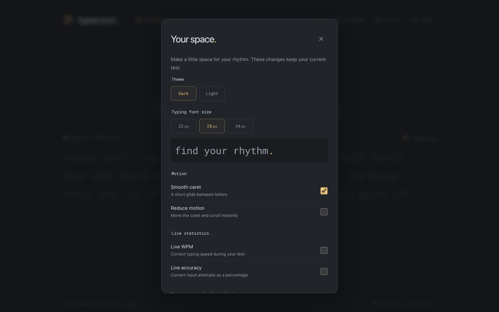
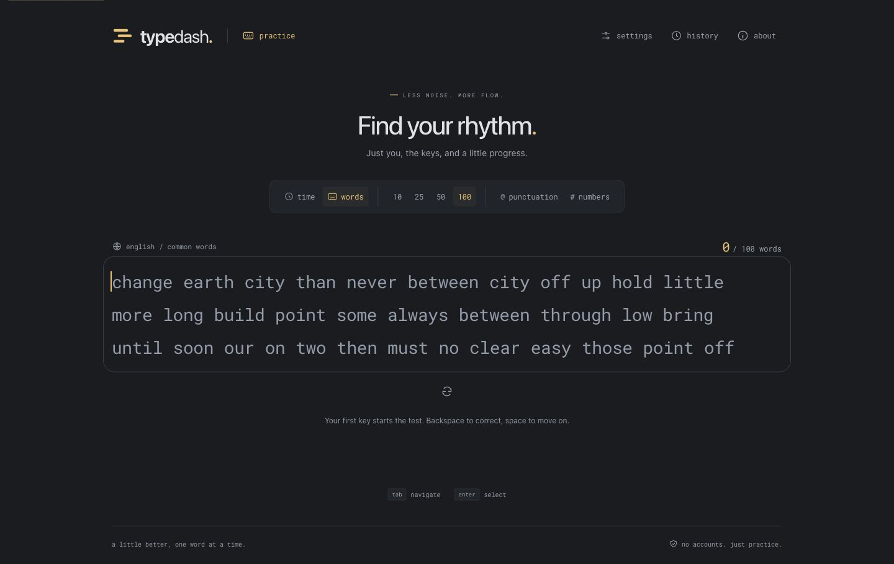
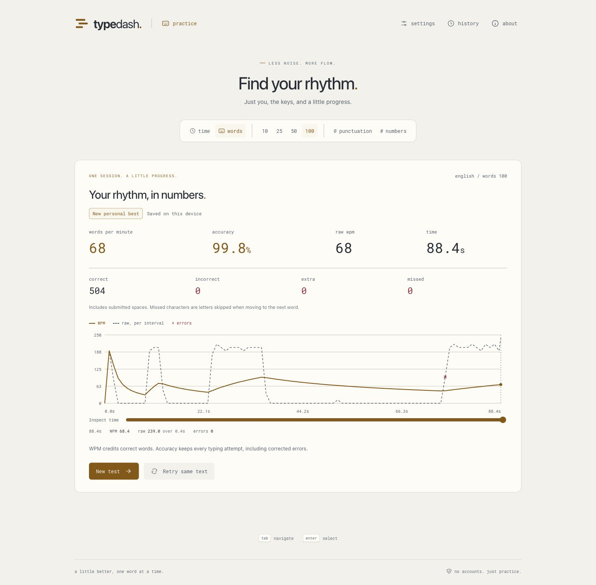
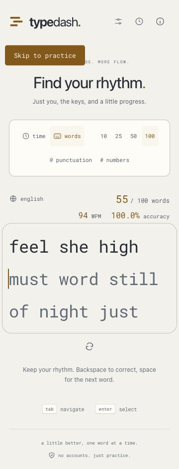
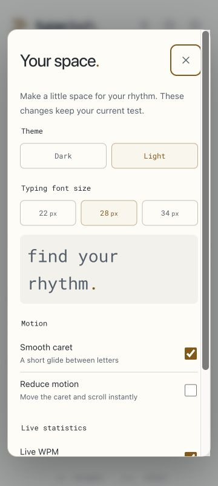
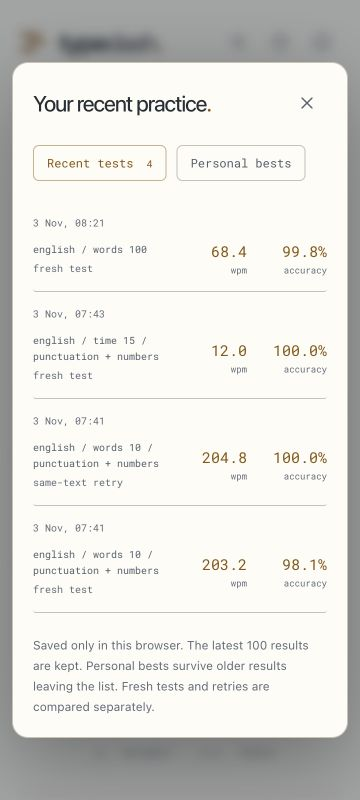

**Phase 5 handoff — themes and interaction polish**

Completed November 3, 2026. Phase 6 is awaiting user approval.

**Delivered**

- A lazy-loaded Settings dialog with dark/light themes, 22/28/34 px typing text, smooth caret, reduced motion, and independent live WPM and accuracy controls. Appearance changes preserve the active run and text. Preferences save automatically in this browser.
- Theme tokens shared by practice, results, charts, history, settings, errors, and focus indicators. A small guarded head script restores the saved light theme before the stylesheet paints. Text colors meet 4.5:1 against both background surfaces in automated checks.
- Preference schema version 2 with a version-1 migration. Test mode, remembered lengths, and modifiers survive migration; completed history and personal-best storage remain version 1 and are untouched. Invalid appearance falls back to defaults while preserving valid test settings. Future schemas and unavailable storage keep their existing protections.
- A single floating caret with a 75 ms same-line transition. Wraps and resize/font measurements place it instantly. App or system reduced motion overrides animation and smooth scrolling while preserving the saved smooth-caret choice.
- Stable prompt windows of at most 64 words. Advancing rebases at the previous line boundary, preserving horizontal wrapping. Line scrolling keeps the active line visible; observers and animation-frame callbacks clean up on unmount.
- Live aggregate metrics capped at ten display updates per second, with no per-keystroke live-region announcements. Input feedback and timing are independent of these display updates.
- Responsive icon navigation, scrollable dialogs with a sticky Settings heading, keyboard focus boundaries, Escape restoration, and History detail/Back focus recovery. No dependencies, login, backend, API keys, or cloud services were added.

**Validation**

| Check | Result |
| --- | --- |
| Lint, TypeScript, production build | Passed with `npm run check`. |
| Unit tests | 114 passed across eight files. Eight added cases cover migration, independent preference writes, invalid appearance, palette contrast, supported sizes, and prompt continuity. |
| Migration | A version-1 preference envelope migrates once, retains both mode lengths, and leaves history bytes unchanged. Existing browser QA history retained its three Phase 4 records. |
| Appearance persistence | Light, 34 px, live WPM/accuracy, and reduced motion survived browser reload. Changing test settings preserves appearance; changing appearance preserves test settings. |
| Active-run preservation | A running 100-word test retained word 55 and its current input while changing theme, font size, and motion. It completed with 504 correct units, zero retained errors, and 99.8% accuracy after a corrected error. Exactly one new result appeared, bringing history to four. |
| Caret and prompt window | At 360 px with 34 px text, the caret stayed visible through 55 words; the first mounted word advanced to 43 with 57 mounted words remaining. Resizing to 768 and 1440 px preserved visibility and introduced no horizontal page overflow. The 100-word run completed correctly. |
| Motion and visibility | The app reduced-motion toggle disabled smooth-caret controls and produced a zero-duration transition. Re-enabling motion produced the 75 ms transition. Live metrics displayed speed and accuracy, and both disappeared when disabled. |
| Keyboard | Settings Tab/Shift+Tab wraps on useful controls; Escape returns focus to Settings. History detail activation focuses its heading; Back restores the inspected row. Restart works with Enter and returns to ready. |
| Narrow layout | Practice, Settings, History, and stored chart details fit 360 px without horizontal overflow. Practice also fits 320 px. Seventy-two extra letters wrapped with the caret visible; word deletion and multiline errors remained usable. |
| Visual review | Ready, typing, blurred, results, Settings, and History reviewed across dark/light states. Mobile Settings and History remain within the viewport. Browser console had no captured warnings or errors. |
| Initial JavaScript | 82,134 bytes gzip against the 100,000-byte budget. |
| Initial assets | 115,906 bytes gzip against the 200,000-byte budget, conservatively including both font alternatives. |

Browser checks ran against the production preview through the supported in-app browser tools. Fifty-one standalone Playwright cases were discovered and type-checked, including nine appearance/keyboard/resize cases across three browser projects; that standalone suite was not executed here. Its system reduced-motion emulation case is prepared but not run. Actual mobile hardware, standalone Chromium/Firefox/WebKit results, cold-load timing, and measured typing/restart latency remain Phase 6 release checks. Bundle size is not a claim of measured interaction latency.

Dependency inputs and the lockfile are unchanged. The development-tool advisory recorded in phase 1 remains tracked there. QA servers are stopped at the end of the phase.

**Review artifacts**

Additional screenshots under `docs/previews/` record dark results, a blurred prompt, a 320 px ready state, and multiline errors.

**Next phase, subject to approval**

Profile loading, typing, and restarts; run available cross-browser release flows; configure Vercel readiness; and document release steps and remaining device checks. Publishing requires separate explicit authorization.
