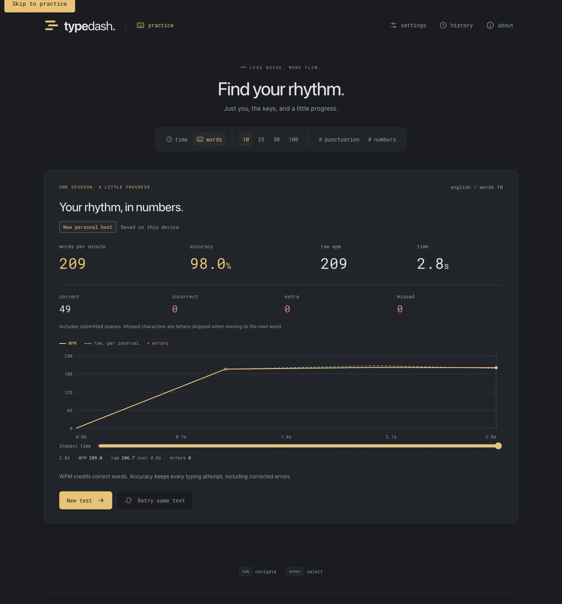
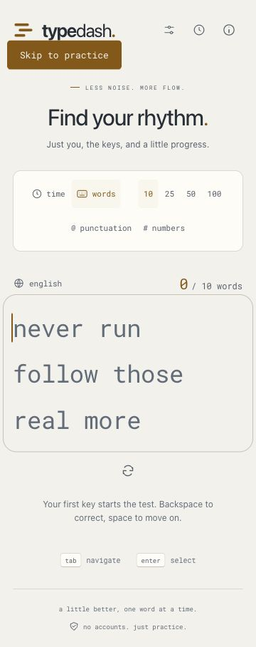
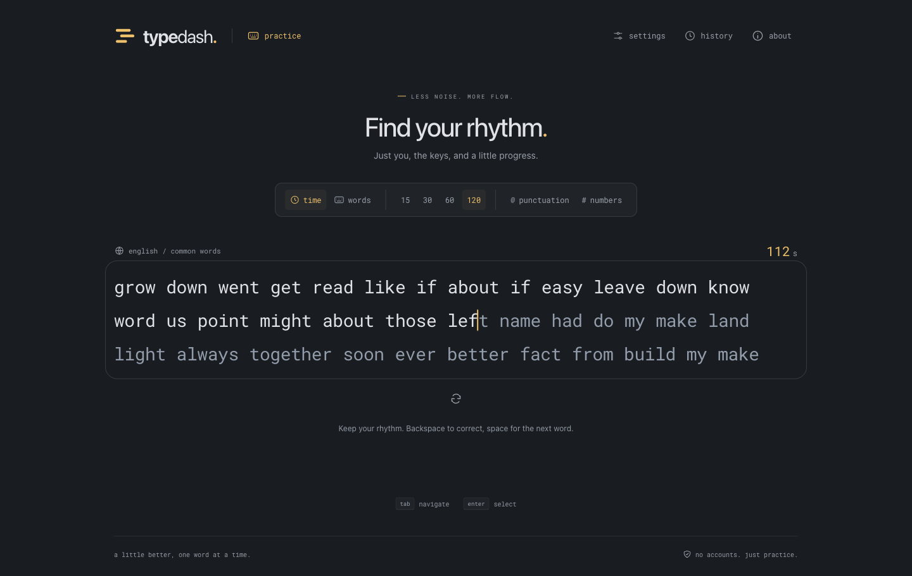

**Phase 6 — performance and Vercel readiness**

Updated November 4, 2026. Implementation and functional validation are finished: 114 unit tests and all 57 Chromium/Firefox/WebKit cases pass. Loading, input-processing, and restart budgets pass. The 32 ms keyboard-presentation gate remains unmet on this test host; it has not been waived or marked complete. No deployment has been performed.

**Delivered**

- A Vercel configuration selecting Vite, Node 24 through the package engine, deterministic npm installation, and `dist`. Hashed assets have a one-year immutable cache policy; root HTML revalidates. This single-document app needs no broad rewrite.
- A preloaded WOFF2 font instead of two bundled alternatives. Initial assets decreased by 15,436 bytes gzip versus Phase 5, including readiness, error recovery, and keyboard improvements.
- Production artifact checks for manifest references, hashed files, one preloaded font, retained licensing, local-only references, and deployment/cache configuration. The HTTP smoke script owns a temporary preview, verifies the document and every built/lazy asset, and stops it.
- A repeatable Node engine benchmark with recorded machine metadata, long fast-typing traces, prompt extension, and restart measurements with 100 results loaded. Its scope explicitly excludes rendering and browser timing.
- A GitHub Actions workflow for lint/types/unit/build checks, HTTP smoke, engine regression, production dependency audit, and functional tests in Chromium/Firefox/WebKit. Manual runs can also record performance evidence. No deployment credentials, push, or publishing action are included.
- A five-run cold-load recorder using Fast 4G and 4× CPU slowdown; native input/restart and next-paint measurements with 100 loaded results; application-listener/request checks; and a separate 160-input screenshot/paint trace. Native Event Timing, with a conservative privacy-rounding bound, enforces presentation budgets. rAF values remain explicitly labeled as proxies.
- Error boundaries for optional lazy panels. A failed graph request leaves result scores and restart controls available; History and Settings failures have contained recovery messages. Added browser regressions cover offline restarts with full history and a graph-download failure.
- Explicit dialog-opener focus restoration and DOM-order zero tab indices. These fix the macOS WebKit keyboard failures found by the standalone suite. Firefox test app data is isolated from protected personal Firefox folders; the suite runs without changing OS permissions or global preferences.
- A native-textarea control case and an offline trace summarizer. Timing failures retain their evidence and make the strict release command fail instead of silently relaxing a target.
- A complete [release guide](./release.md), including commands, environment details, Vercel deployment steps, cache verification, origin-local storage, actual-device checks, and rollback behavior.

**Executed validation**

| Check | Result |
| --- | --- |
| Lint, types, unit tests, production build | Passed with `npm run check`; 114 tests across eight unit files. |
| Artifact and deployment configuration | Passed. Eight hashed assets, one preloaded WOFF2 font, build/cache rules, and attribution validated. |
| Production HTTP smoke | Passed for the root document and nine static/lazy assets. This is local file-serving verification, not a live Vercel header result. |
| Production dependency audit | Zero vulnerabilities reported by `npm audit --omit=dev` on November 4, 2026. |
| Reducer benchmark | Apple M2, arm64 macOS, 8 logical CPUs, 16 GiB RAM, Node 24.21.0. Ten measured 3,000-character traces after three warmups, simulating 300 WPM for 120 seconds. Largest logical buffer: 640 words. |
| Reducer insertion | 30,000 samples; p95 0.0007 ms; p99 0.0014 ms. This excludes native dispatch, React, layout, and paint. |
| Reducer restart | 1,000 samples after 100 warmups; p95 0.0151 ms with a 100-record store loaded. This does not establish restart-to-presentation latency. |
| Fresh browser run | Default 30-second settings appeared. A 10-word test retained 49 correct units, zero retained errors, and 98.0% accuracy after one corrected mistake. Scores, graph, and local saving worked. |
| Browser cleanup/persistence | Same-text retry reproduced all ten words. Ten abandoned restart cycles returned to ready with focus and ten mounted words. History still had exactly one completed result. The 10-word preference survived reload. |
| Responsive browser review | The new preloaded font reference resolved to the hashed WOFF2 asset. Light theme with 34 px text had no page overflow at 360, 768, or 1440 px. No captured browser warnings/errors in these normal flows. |
| JavaScript budget | 82,348 bytes gzip, below 100,000. |
| Total initial asset budget | 100,470 bytes gzip, below 200,000; Phase 5 was 115,906. |
| Cross-browser suite | 57 passed in 29.0 seconds, with zero failures, skips, retries, or flaky results: Chromium 156.0.8078.4 (19), Firefox 157.0 (19), WebKit 27.2 (19). |
| Cold loading | Five fresh Chromium contexts, disabled cache, 4× CPU slowdown, Fast 4G at 1,012,500 B/s down, 168,750 B/s up, 165 ms latency. Median LCP **660 ms**, input readiness **622.8 ms**; targets 1,500/2,000 ms. |
| Native input processing | Latest headed run: 275 characters at measured 266.8 WPM; p95 **2.5 ms**, below 4 ms. |
| Restart | Twenty restarts with 100 loaded records: ready/focus rAF p95 **15.6 ms**; native click-to-next-paint p95 conservative bound **44 ms**, below 100 ms. |
| Listener/DOM/network stability | Application-owned listener counts stayed at window 3, document 1, input 9. Mounted words remained ≤64. No requests occurred during sustained typing and restarts. Playwright's injected listeners are preserved in total counts and excluded from the application comparison by script ID. |
| Browser cadence | Headed Chromium: median rAF interval 16.7 ms over 120 samples, approximately 60 Hz. Physical display mode and power state were not independently certified. |
| Keyboard presentation — failed gate | Latest untraced Event Timing run: rounded p95 **48 ms**, conservative upper bound **52 ms**, versus the **32 ms** target. Earlier headed runs reported rounded p95 40 ms / bound 44 ms. This is a next-paint measurement, not a handler or rAF substitute. |
| Native control | A plain textarea with no TypeDash code, in headed Chromium, reported rounded p95 **40 ms** / conservative bound **44 ms** across 265 keys. It also exceeds 32 ms. This suggests a similar host/browser presentation floor; it does not certify another device's latency. |
| Diagnostic trace | Latest trace contains 160 input markers, 160 commit markers, and 424 screenshots. Native trace Event Timing p95 was 54.52 ms with screenshot recording enabled. This intrusive recording is kept separate from the untraced benchmark. |

The user explicitly authorized standalone Playwright tests and performance recording on November 4. All three official browser builds were installed and executed against isolated production previews. The final functional run passed all 57 cases. The strict headed performance suite passed loading and the native control recording, and failed its keyboard-presentation assertion. The latest interaction rerun also passes processing, restart, listener, and network checks and fails only the 32 ms presentation assertion. TypeScript's missing draft `durationThreshold` property is locally typed in the test harness; no production polyfill was added.

Dated evidence is preserved under `docs/performance/`: [browser/build summary](./performance/browser-checks-2026-11-04.json), [loading](./performance/loading-2026-11-04.json), [interaction](./performance/interaction-2026-11-04.json), [native control](./performance/native-baseline-2026-11-04.json), [diagnostic trace summary](./performance/trace-summary-2026-11-04.json), [asset sizes](./performance/bundle-2026-11-04.json), and [engine benchmark](./performance/engine-2026-11-04.json). The build entry and its SHA-256 identify the tested source output. Large traces remain in ignored `performance-results/` locally and are uploaded by the optional CI recording step.

Event Timing rounds durations to the nearest 8 ms. The recorder adds 4 ms to observed durations and includes below-threshold events conservatively, following the [Event Timing specification](https://www.w3.org/TR/event-timing/). It verifies the keyboard event count and enforces the original target. Screenshot capture time is not used as presentation time. The native control's failure points to an environment limitation, but does not justify silently treating the TypeDash gate as passed.

Dependency versions and the lockfile are unchanged. The development-only advisory documented in Phase 1 remains tracked there; the production audit is clean.

**Remaining release gates**

| Gate | Status and next action |
| --- | --- |
| Chromium, Firefox, WebKit functional suite | Passed: 57/57 on the final build. |
| Five-run cold-load medians | Passed: 660 ms LCP and 622.8 ms readiness. |
| Native input/restart timing and listener/network stability | Passed, including native restart presentation, stable application listeners, bounded DOM, and zero new requests. |
| Input-to-visible-feedback ≤32 ms p95 | **Not met on this host.** Keep open for a reference-environment run or an explicitly accepted change to the gate. Normal headed runs reported conservative bounds of 44–52 ms; the native control was 44 ms. |
| Actual phone keyboards/system motion | Pending iOS Safari and Android Chrome hardware checks. Desktop viewport checks are not device certification. |
| Live Vercel smoke/cache headers | Pending separately authorized deployment and inspection of its actual URL. |

Phase 6's validation gate remains open until the keyboard presentation target passes on the reference environment or the owner explicitly accepts a revised gate. `npm run check` passes; `npm run test:performance -- --headed` and the full release command fail the presentation budget on this host. Publishing still requires explicit authorization. Owned local preview servers and browser processes are stopped after testing.

**Review artifacts**

